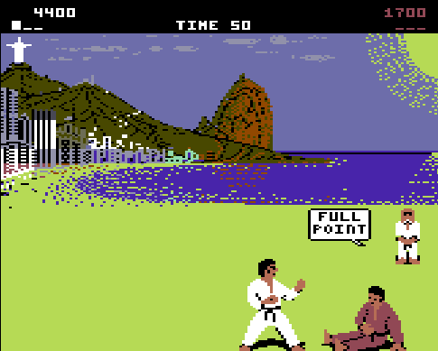

# IK748 - International Karate C64 ported to Uzebox video mode 748

IK748 is a conversion of C64 International Karate to the Uzebox.

It has rewritten game logic (main.c, fight.c, ai.c, hud.c, sfx.h).

The full game logic is here including the bonus rounds.

It requires graphics, sound and optionally music data to be extracted from C64 IK to build the source.

sid2uze.py was written to convert the Rob Hubbard composed music for this IK port. sid2uze should be
reusable by other C64 to m748 ports. Maybe it can be expanded to support more SPI RAM video modes?

## Build

See IK748_BUILD.txt in the same directory as this README.

## Play

Title screen: left/right picks 1 PLAYER or 2 PLAYERS, Start (or A/B) begins.

- 1 player: pad 1 is white, the computer is red. Win a bout to go to the next stage against a
  faster, more aggressive opponent; lose and it's GAME OVER.
- 2 players: pad 1 white, pad 2 red.

Eight directions, each with and without fire (A/B/X/Y), give the sixteen moves. Pulling away
while the opponent strikes close by blocks; up+away turns round (fighters can pass each other,
as on the C64). Fire with the stick centred does nothing. A full point by a fighter who already
has a full point wins the bout.

Sound effects: the game's own six sampled effects, extracted from your copy by
export_moves.py and played on the inline mixer's PCM channel (SOUND_CHANNEL_5_ENABLE=1) at
the original rate, triggered by the C64's own rules (attack frames, after a point plus a
delayed second sample, falls in the knife round, each brick in the breaking round).
The samples are normalised to full scale, and the ones played on attack frames get extra
gain with soft clipping for more impact. Original synthesised patches cover what the C64
doesn't sample: block, bonus-round success, game over and the menu.

## Bonus rounds

One player: the breaking round after your 4th win, the knife round after your 9th.

Two players: the original fixed order of bouts and bonus rounds; each player takes
the bonus round in turn.

- Breaking round: wait behind the bricks; when the bubble says GO! press anything. The
  faster you react, the more bricks break (1-10): 100 points each, 2000 for all ten. As on
  the C64 a crack runs down the middle of the stack, one brick per break, from the top.
  Too late is TOO SLOW.

- Knife round: 10, 15 or 20 knives and other projectiles at the original heights and
  speeds; jump (up) or duck (down). A hit knocks you down. 100 points per projectile
  dodged.

## Display

IK uses video mode 748. It splits the screen into three sections using Mode 748's per-row modes.
Each 8-line tile row has its own mode, chosen from a 32-entry row table in `main.c`. The port uses three of them:

| Tile rows | Lines | Row mode | What's there |
|---|---|---|---|
| 0–11 | 0–95 | Mode 4: 4bpp bitmap streamed from SPI RAM | HUD (rows 0–1) and the scenery |
| 12–23 | 96–191 | Mode 0: 4bpp tiles | Ground, referee, fighters and all other sprites |
| 24–31 | not displayed | Mode 2: plain separator rows | Unused padding at the end of the table |

**Mode 4 rows (the top half)**

- The scenery and HUD are one 192-pixel-wide, 16-colour bitmap per stage in SPI RAM, so the original's full palette is kept.
- Mode 4 has to start the frame, which is one reason the HUD is drawn into this bitmap rather than in a separate text mode.
- The bitmap's leftmost 24 pixels come from a small RAM buffer instead of SPI. The picture is offset to start at x=24, so that column is plain black, and one shared 96-byte buffer serves all twelve rows.
- The HUD text, scores and markers are written straight into the bitmap's top lines in SPI RAM.

**Mode 0 rows (the bottom half)**

- Each stage's ground is a set of up to 256 ROM tiles in flash, with the tile map for each row in SPI RAM.
- These are the only rows where Mode 748 can draw sprites, which is why the screen is split here. The fighters, speech bubbles, brick stack and knives are all sprite tiles from SPI RAM, drawn into RAM tiles on these rows.
- A fighter's jump only ever reaches 13 lines above the C64's ground band, so it never needs sprites in the bitmap area.

**What isn't used**

- No scrolling: the row selector has a single entry, putting logical line 0 at the top.
- No palette splits: one 16-colour palette per stage covers the whole screen.
- The single-colour text modes 6 and 7 and the 3bpp bitmap mode 5 aren't used. The 4bpp bitmap kept the HUD and scenery simpler.
- 192 of the possible 224 lines are displayed. The C64's bottom credit row is left out to give more blank time between frames, which the sprite drawing needs.

The game's error screen is the only other layout: a full screen of mode 2 rows in a single colour.

## Notes

- Sprites are redrawn only when they change, starting as soon as the last line is rendered;
  this fixed the flashing front foot (the last tile drawn used to miss the beam).
- The C64 credit row at the bottom is not shown (192 lines), for more blank time.
- Mode 4's line buffer is moved to 0x05A0 (m74cfg.h) so the main stack has 224 bytes;
  at the default 0x1020 the sound code's call depth overflowed into it and the picture
  went black. C64 globals must therefore end below 0x05A0 (the build checks).
